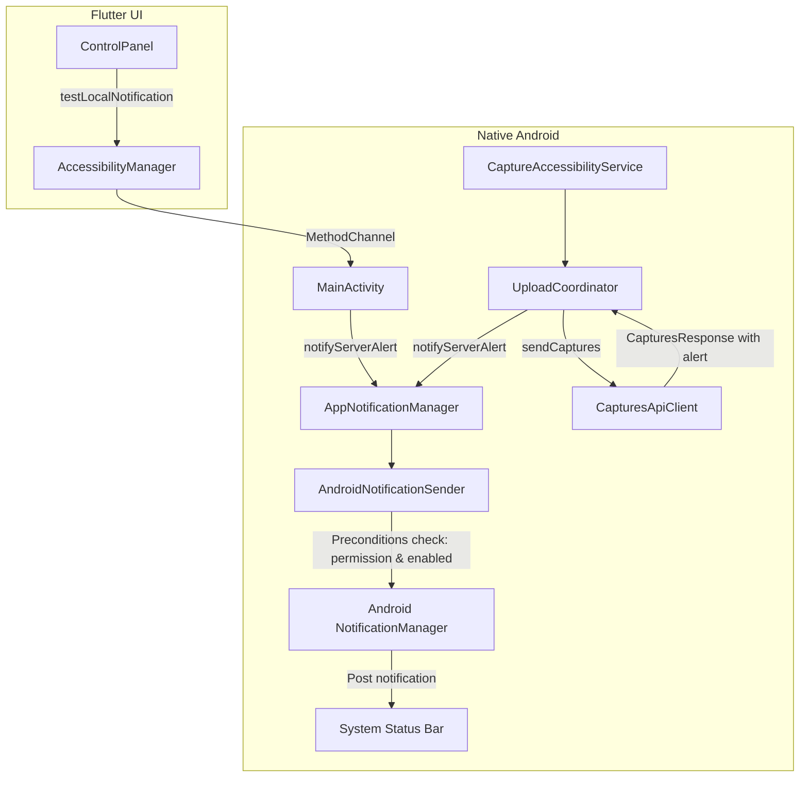

# Notification System (Phase 1 & Phase 2 Architecture)

This document provides a comprehensive guide for teammates working on or extending the notification system in `digital_assistant`.

---

## 1. Overview & Goals

The notification system provides a decoupled, modular pipeline to alert the user of important events. 

- **Phase 1 (Current):** Handle backend classification alerts. When UI events and screen summaries are uploaded to `/v1/captures`, the backend content classifier analyzes the batch. If suspicious activity, sensitive prompts, or security risks are detected, the API responds with an optional `alert` object. The Android app parses this detection response and delivers an alert notification to the user.
- **Phase 2 (Upcoming):** Support additional notification types, such as push notifications and background system status alerts.
- **Testing Utility:** Built-in Flutter UI trigger and native MethodChannel method to test sending local notifications (`"Hello notification"`).

---

## 2. Architecture & Components



### Key Classes

| Class | Package | Responsibility |
| :--- | :--- | :--- |
| [`AppNotification`](file:///android/app/src/main/kotlin/com/example/accessibility_service/notification/NotificationModels.kt) | `...notification` | High-level data class storing notification ID, type, title, message, and metadata payload. |
| [`NotificationType`](file:///android/app/src/main/kotlin/com/example/accessibility_service/notification/NotificationModels.kt) | `...notification` | Enum defining notification categories (`SERVER_ALERT`, `PUSH_NOTIFICATION`, `SYSTEM_STATUS`) along with Android channel IDs and importance. |
| [`AppNotificationSender`](file:///android/app/src/main/kotlin/com/example/accessibility_service/notification/AndroidNotificationSender.kt) | `...notification` | Abstraction interface for notification posting and preconditions checking, facilitating clean unit testing without Robolectric or emulator. |
| [`AndroidNotificationSender`](file:///android/app/src/main/kotlin/com/example/accessibility_service/notification/AndroidNotificationSender.kt) | `...notification` | Concrete implementation handling Android notification channel setup, Android 13+ runtime permission verification (`POST_NOTIFICATIONS`), and native notification building. |
| [`AppNotificationManager`](file:///android/app/src/main/kotlin/com/example/accessibility_service/notification/AppNotificationManager.kt) | `...notification` | Singleton/orchestrator providing clean helper methods (`notifyServerAlert`, `notifyPush`, `notifySystemStatus`, `cancel`) and thread-safe notification ID generation. |
| [`ServerAlertResponse`](file:///android/app/src/main/kotlin/com/example/accessibility_service/networking/CapturesApiModels.kt) | `...networking` | Model representing detection data returned by the backend in `CapturesResponse`. |

---

## 3. Preconditions & Permissions

Before any notification is posted, `AndroidNotificationSender.canSendNotifications()` verifies that:
1. `NotificationManager` system service is available.
2. System notifications are enabled for the application (`areNotificationsEnabled()`).
3. For devices running Android 13+ (API level 33+), the `android.permission.POST_NOTIFICATIONS` runtime permission has been granted.

If any check fails, the notification is safely dropped and logged without crashing or stalling the upload pipeline.

Notification channels created on Android 8.0+ (API 26+):
- **Server Alerts Channel (`server_alerts_channel`):** `IMPORTANCE_HIGH`
- **Push Notifications Channel (`push_notifications_channel`):** `IMPORTANCE_DEFAULT`
- **System Status Channel (`system_status_channel`):** `IMPORTANCE_LOW`

---

## 4. Backend JSON Protocol (Phase 1)

When the backend detects classified content, it includes an optional `alert` object in the upload response:

```json
{
  "accepted": 10,
  "skipped": 0,
  "config": {
    "batch_size": 30,
    "flush_seconds": 20
  },
  "commands": [],
  "alert": {
    "title": "Phishing Warning",
    "message": "Potential credential harvesting screen detected.",
    "alert_type": "SECURITY_ALERT",
    "metadata": {
      "confidence": "0.94",
      "category": "credentials"
    }
  }
}
```

The parser in [`CapturesResponseParser`](file:///android/app/src/main/kotlin/com/example/accessibility_service/networking/CapturesJsonSerializer.kt) flexibly parses this object with fallbacks (e.g. accepting `type` if `title` is missing, or `description` if `message` is missing).

---

## 5. Testing Local Notifications

To verify notifications manually:
1. Launch the app on an Android device or emulator.
2. Open the **Control Panel** page.
3. Tap **"Test local notification"**.
4. The Flutter UI will call native `MainActivity` via `MethodChannel` (`testLocalNotification`), triggering `AppNotificationManager.notifyServerAlert` with:
   - **Title:** `"Test Notification"`
   - **Body:** `"Hello notification"`
   - **Type:** `TEST_ALERT`
5. A SnackBar will confirm whether the notification was dispatched or if preconditions (permissions) blocked it.

To run automated unit tests:
```bash
./gradlew testDebugUnitTest
```
All notification tests are located in:
- `android/app/src/test/kotlin/com/example/accessibility_service/notification/AppNotificationManagerTest.kt`
- `android/app/src/test/kotlin/com/example/accessibility_service/networking/CapturesResponseParserTest.kt`
- `android/app/src/test/kotlin/com/example/accessibility_service/upload/UploadCoordinatorTest.kt`
